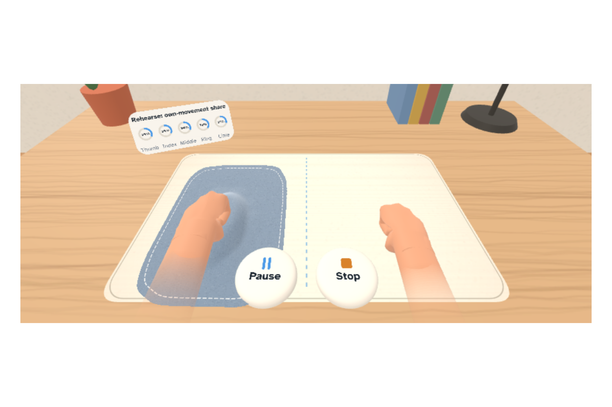
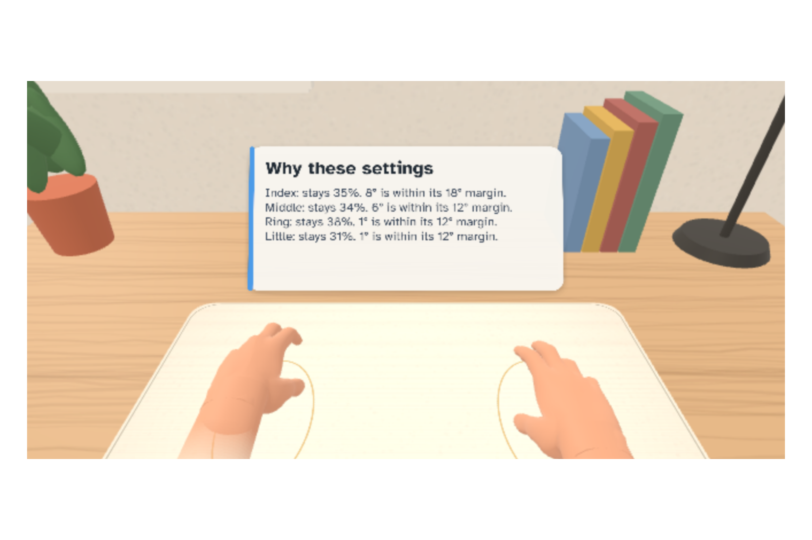
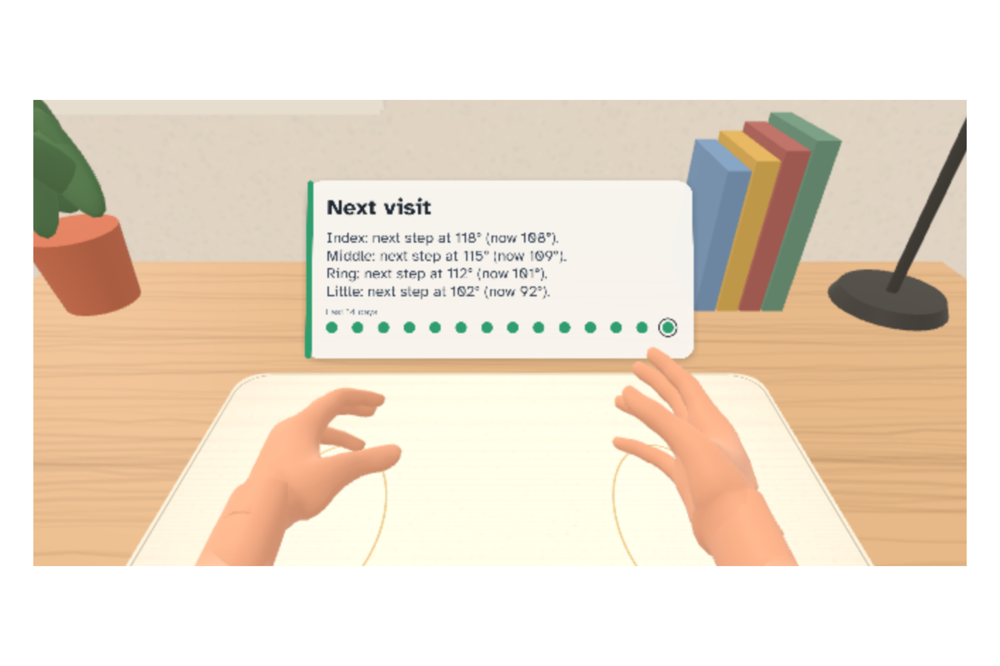
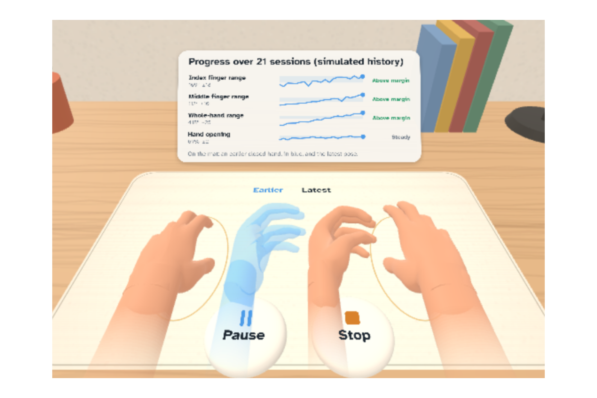
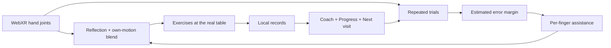

# Understudy


**A daily mirror exercise for someone practising with one weaker hand, with assistance set finger by finger.**

I built Understudy around a morning at the same table: measure, practise, then inspect what the next visit could change. I am Marc Donovici, a technology auditor, building solo.

| Try it | Competition | Built with | Retained evidence |
|---|---|---|---|
| [Play without an account](https://marc-dvci.github.io/Understudy/) | Meta VR Start 2026 · Productivity · New Experience | Meta Immersive Web SDK 1.0.1 · TypeScript · WebXR | 178 passing unit tests · 4 input journeys · 60 room-placement cases |

**[Watch the demo](https://youtu.be/GQnz-b9IVoE)** · [Interactive explanation](https://marc-dvci.github.io/Understudy/evidence.html) · [Judge guide](docs/JUDGE_GUIDE.md)

## For judges

| Criterion | What to inspect | Evidence |
|---|---|---|
| Innovation & Creativity | Each finger independently blends the Lead’s reflection with its own tracked movement | Handover chapter; [assistance rule](src/core/assistance.ts) |
| Experience Design | A seated morning routine, one-hand navigation and a visible next visit; Desk Break for two working hands | First and later-session routes; [coach and return loop](src/core/coach.ts) |
| Technical Implementation | Hands drive measurements, mirror and input; detected surfaces place the station | [Validation](validation/REPORT.md); [emulator results](verification/emulator.json); [physical Quest protocol](docs/QUEST_TEST_PROTOCOL.md) |
| Polish & Presentation | Real app footage, readable controls, per-finger explanations and an earlier-pose comparison | Demo video; Progress chapter; gallery below |

## See it work



The coach explains why a setting changed or stayed. These are actual product screens captured from the public build in [Meta IWER](https://github.com/meta-quest/immersive-web-emulator), Meta’s browser-based immersive-session emulator. Hands and prepared history are simulated.



Next visit shows each finger’s next threshold beside its current range. A missed day stays a gap in the visit dots.



Progress places an earlier closed-hand pose beside the latest and labels change relative to estimated measurement error.

## Try it

Desktop Chrome or Edge: open the play link and choose **Explore handover**. Compare Watch, Rehearse and Perform. Switch to **Progress** or **Hand Print**, or pause to inspect a state. These chapters use the application’s own assistance and measurement functions over 21 prepared visits. The mode comparison uses a prepared calibration; the full routine also calibrates tracking noise and detects attempts.

**Watch the first session** runs onboarding and a complete routine. **Watch a later session** includes the coach’s plan, its per-finger explanations and Next visit. **Watch a desk break** runs the short routine for two working hands. Sample routes use temporary storage, separate from personal records.

Quest 3 / 3S: open the plain play URL in Quest Browser, enable hand tracking, sit at a stable table and put controllers down. Choose **Start**. Rest the working hand to place the station, then choose a side and programme. **Later visit** on Home opens labelled sample history. Pause and Stop sit at the near edge of the mat.

## The daily loop

**Measure → set assistance per finger → exercise → compare next time.**

A mirror exercise gives the weaker hand a reflected movement to follow. Understudy makes the amount of help inspectable across visits. The working hand is the **Lead**; the weaker hand is the **Understudy**. A Hand Print measures opening, fist and thumb reach over repeated trials. A virtual felt cloth covers the weaker hand at the real table.

Watch follows the reflection. Rehearse blends it with tracked own movement. Perform follows own movement. The percentage is the rendered own-movement share. Assistance changes only when measured range crosses an estimated margin relative to its last-change anchor. The deterministic coach plans the routine from saved measurements and explains each setting.

Eight table exercises include flower, piano, thumb, rhythm, stones to the bowl, turn the dial, spread and wave. A short Desk Break serves two working hands; Phantom and Morning Warm-up offer other hand routines. Visit connects two tables through a four-digit code and exchanges hand-joint poses. Settings exports CSV or a one-page care-team summary.

## How it works



The Lead’s 25 joint matrices reflect across the resting palms’ midline. Joint-local blending preserves bone lengths. Each measurement needs enough tracked frames and at least two usable trials. The starting error prior comes from a stated synthetic tracker model; a personal estimate replaces it after five usable sessions. MDC95 = 1.96 × √2 × SEM. Historical assistance uses only the records available on that day.

| Meta capability | Its role in the product |
|---|---|
| Immersive Web SDK / WebXR | Runs the immersive session, reads hand joints and renders the station |
| Hand tracking | Drives measurements, the mirror and button input |
| Passthrough and surface understanding | Makes the user’s table set the station’s position; resting-fingertip and lap fallbacks handle other placements |
| Spatial anchors | Can restore the station within reach on a later visit |
| IWER | Executes the real application with synthetic hands and room profiles for demonstrations and retained verification |

## Evidence and reproduction

| Claim | Implementation | Verification |
|---|---|---|
| Per-finger reflection and own-motion blend | [rehearse.ts](src/core/rehearse.ts) | [Mirror geometry and fallback tests](tests/mirror.test.ts) |
| Assistance changes beyond an estimated margin | [assistance.ts](src/core/assistance.ts), [records.ts](src/core/records.ts) | [Assistance tests](tests/assistance.test.ts), [core tests](tests/core.test.ts) |
| Missing readings stay unavailable | [measure.ts](src/core/measure.ts) | [Tracking-gap and measurement tests](tests/core.test.ts) |
| Poke, dwell, thumb and head-gaze selection | [press.ts](src/app/ui/press.ts) | [Input tests](tests/press.test.ts), [four emulator journeys](verification/e2e-results.json) |
| Temporary samples and confirmed erasure | [store.ts](src/app/store.ts) | [Storage tests](tests/store.test.ts) |
| Plans and explanations follow from records | [coach.ts](src/core/coach.ts) | [Coach tests](tests/coach.test.ts) |
| Joint-based turn, wrist lift, pinch and repetitions | [movement.ts](src/core/movement.ts) | [Movement tests](tests/movement.test.ts) |
| Visit rejects malformed hand-pose frames | [pose-codec.ts](src/core/pose-codec.ts) | [Codec tests](tests/pose-codec.test.ts) |
| Spoken commands require an unambiguous visible label | [voice-intent.ts](src/core/voice-intent.ts) | [Voice tests](tests/voice-intent.test.ts) |
| Care summary escapes data and rejects invalid numbers | [report.ts](src/core/report.ts) | [Summary tests](tests/report.test.ts) |

| Result | Scope | Reproduce or inspect |
|---|---|---|
| 178 passing unit tests | Automated software | `npm test`; [software.json](verification/software.json) |
| 4 complete input journeys | IWER; retained 17 October 2026 | With the managed dev server running: `node tools/e2e-suite.mjs`; [results](verification/e2e-results.json) |
| 60 / 60 room-placement cases | IWER; retained 24 September 2026 | [Room results and method](validation/REPORT.md#s6-rooms-the-app-was-never-tuned-on) |
| 20.8° index-range MDC95 | Stated synthetic tracker model | `npm run validate`; [S2 results](validation/REPORT.md#s2-measurement-error-per-hand-print-metric) |

The screens run the real application; the demonstration hands, histories and uncertainty model are simulated. This is an exercise prototype with estimated measurements. Physical Quest frame rate, tracking accuracy, anchor persistence, comfort, intended-user usability and clinical benefit require separate validation. The held-out 5° single-finger attempt detector reaches 23.4% sensitivity, so very small attempts can be missed in Rehearse. The [validation report](validation/REPORT.md) preserves the original reference results alongside later regressions.

## Run locally

Use Node 22.12+ or 24 LTS; the repository’s `.nvmrc` selects the CI runtime. No application credentials are required.

```powershell
npm.cmd ci
npm.cmd run dev
```

Open the managed HTTPS runtime, normally `https://localhost:8081/`. Stop it with `npm.cmd run dev:down`. On other shells, use `npm` in place of `npm.cmd`.

```powershell
npm.cmd run typecheck
npm.cmd test
npm.cmd run validate
npm.cmd run build
```

`?fresh` opens onboarding, `?fresh&seed=21` a later simulated visit, and `?fresh&program=deskbreak` a Desk Break. Build includes the browser emulator and generates the public explanation from the app’s own model.

## Privacy, layout and licence

Personal records stay in IndexedDB. Sample routes use temporary storage. Confirmed erasure clears records, settings and the stored anchor. Hosting providers receive normal asset requests; offline use needs a successful online visit. Visit uses a public PeerJS broker to introduce the browsers, then exchanges joints over peer-to-peer WebRTC. Optional spoken commands use the browser’s speech recognition service.

`src/core` holds measurement and decision logic; `src/app` holds rendering and flows; `tests` holds software checks; `validation` and `verification` hold methods and evidence; `docs` holds the judge and device-test guides.

Understudy is [MIT licensed](LICENSE), copyright Marc Donovici. Bundled third-party licences and attribution remain in the repository.
