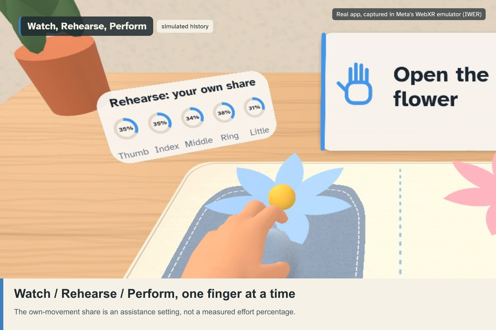

# Understudy: judge guide

Understudy is a seated daily mirror exercise. Its distinctive loop is **measure, set assistance per finger, exercise, compare on the next visit**. The working hand leads a reflection above the weaker hand; repeated measurements determine how much each finger follows that reflection.

**Demo video:** <https://youtu.be/GQnz-b9IVoE>

## Explore in a browser

Open the hosted HTTPS build in desktop Chrome or Edge and choose **Explore handover**. It runs the actual app in Meta IWER with simulated hands and prepared sample history.

| Chapter | What to inspect |
|---|---|
| Handover | Compare Watch, Rehearse and Perform on the same simulated movement. Rehearse uses the app's assistance rule over 21 prepared visits. The percentages describe the render blend. |
| Progress | An earlier blue hand beside the latest closed-hand pose, with changes labelled relative to an estimated measurement-error margin. |
| Hand Print | The simulated actor performs three movements, three times, through the live measurement path. |

The chapter controls work with mouse or keyboard. Pause freezes the flow; Replay restarts a chapter. Full app opens the complete later-session route. The showcase saves no new session. Its mode comparison uses a prepared calibration with the attempt gate held open; the full routine also measures tracking noise and detects attempts.

Choose **Watch the first session**, then **Watch the demo**, for complete onboarding. **Watch a later session** demonstrates the complete routine with three weeks of sample history: the coach's plan, one sentence per finger explaining its setting, the newer table exercises and the Next visit board. **Watch a desk break** runs the two-minute routine for two working hands. Phantom, Morning Warm-up and Desk Break can be selected during onboarding. Sample history is temporary and explicitly simulated, separate from personal records.

On a headset, Home also offers **Later visit**, which shows visit 22 over labelled sample history without touching personal records, and **Visit**, which connects two tables by a four-digit code so each person sees the other's hands across the mat.

The site's **See how it works and what has been verified** page includes an interactive, visit-by-visit sample generated from the same assistance and progress functions. It can be read without the emulator.

On a physical Quest 3 / 3S, open the plain build URL in Quest Browser, enable hand tracking, put controllers down and sit at a stable table. Choose Start, follow the room permission prompt, and rest the working hand to place the station. Settings → Device check shows this session's median frame rate and the share of frames within the 60 fps budget.

## Match the rubric to the app

| Criterion | Product decision | Inspectable evidence |
|---|---|---|
| Innovation & Creativity | Assistance changes independently for each finger when range exceeds its estimated margin | Handover chapter; [assistance rule](../src/core/assistance.ts), [causal history replay](../src/core/records.ts) |
| Experience Design | A short, seated routine at an existing table, with one-hand controls and an observable next visit | First-session route; [table placement](../src/app/station.ts), [input](../src/app/ui/press.ts) |
| Technical Implementation | Hand joints drive measurements and the reflection; local storage and bundled assets support offline use; a 72 Hz request and shaders compiled before the routine hold the frame budget | [Measurement](../src/core/measure.ts), [mirror](../src/app/mirror-system.ts), [tests](../tests), [validation](../validation/REPORT.md), [frame budget](PERFORMANCE.md) |
| Polish & Presentation | Felt, stone controls, short voice cues, captions and a labelled earlier-pose comparison | Interactive chapters, [Progress](images/progress.jpg), [architecture](images/architecture.jpg) |

The reason to return is on the table: each visit saves a measurement at the same station, Progress shows what changed, and Next visit shows what the next session can change. One-hand poke, dwell, thumb confirmation, head gaze, spoken commands and eye-gaze select keep every control reachable.

## Read results at their stated scope

180 unit tests pass. Emulator journeys completed for a desk break, a coached later visit, the in-headset later visit, a two-tab Visit and the spoken commands. Four first-session input journeys and all 60 scanned-room placement checks completed in the emulator on 24 October 2026, on the current build. The [validation report](../validation/REPORT.md) records dates, assumptions and thresholds.

[PERFORMANCE.md](PERFORMANCE.md) describes how a session holds Quest's frame budget and what was measured in the emulator. Tracker accuracy, anchor persistence, comfort, intended-user usability and clinical benefit require separate validation.

The stated 5° attempt detector reaches 23.4% single-finger sensitivity and misses its original target. Small movements can be missed. The sample illustrates the model's behavior; it does not represent measured recovery.

[Official judging criteria](https://start-developer-competition-26.devpost.com/details/judging) · [Special awards](https://start-developer-competition-26.devpost.com/details/special-awards) · [Rules](https://start-developer-competition-26.devpost.com/rules).
